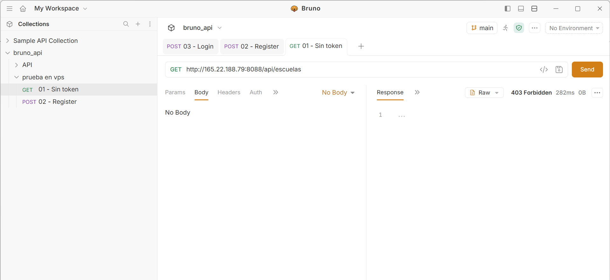
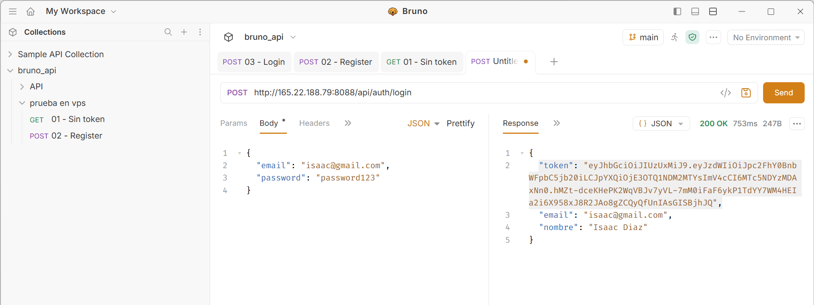
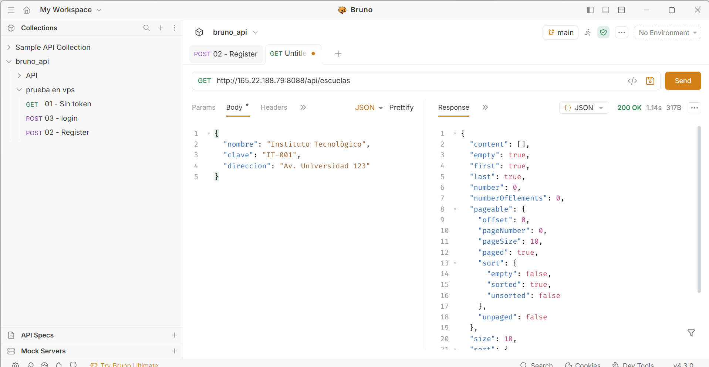
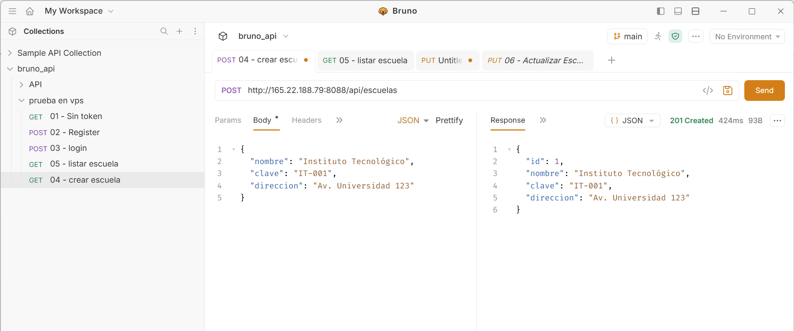
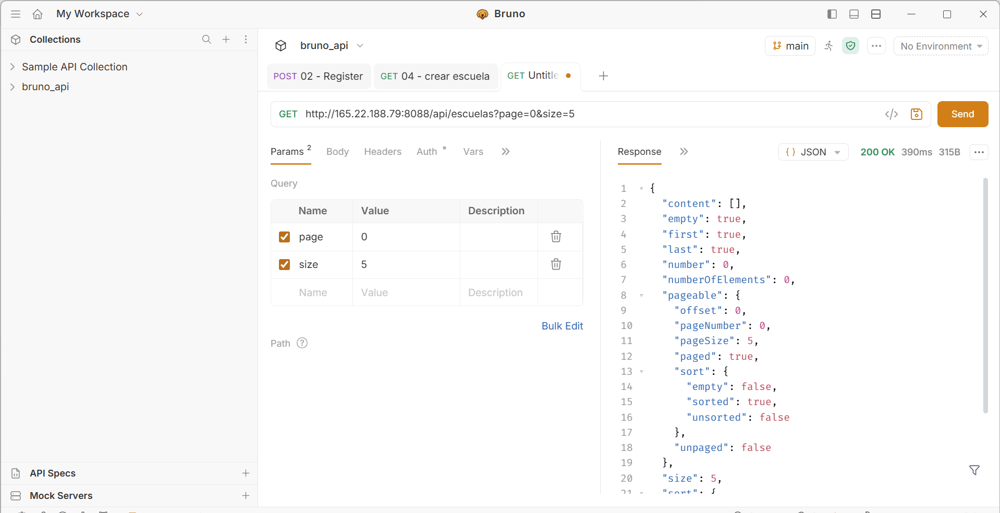
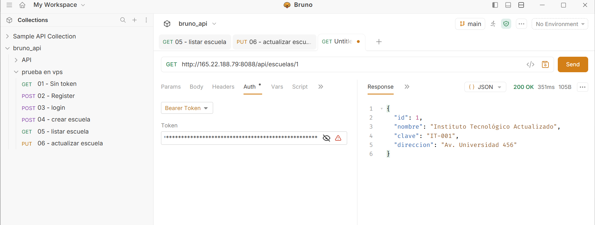
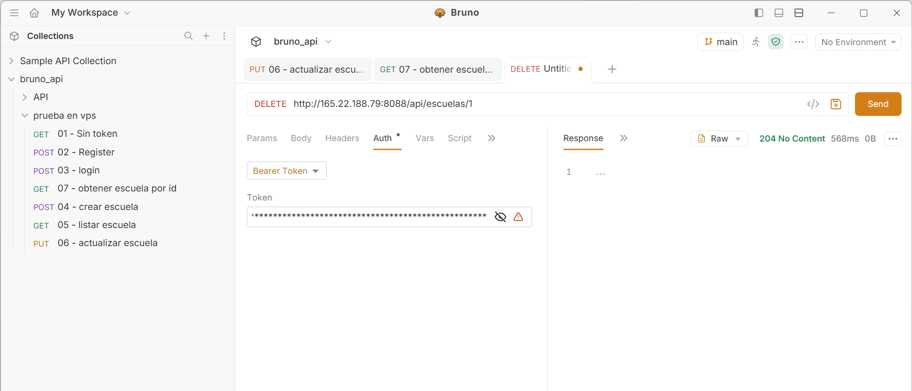

# Act4. API REST con Spring Boot, Spring Security y JWT — `DMIEact4_t4`

## Descripción de la Actividad
La aplicación gestiona un sistema de control escolar seguro desarrollado en **Spring Boot** y **MySQL**. Implementa autenticación mediante **JWT (JSON Web Tokens)** con Spring Security, transferencia de datos mediante **DTOs**, validaciones con `@Valid` y paginación de resultados, exponiendo sus endpoints como servicios RESTful probados y documentados en **Bruno**

## Arquitectura y Seguridad
- **Autenticación Stateless (`JWT`):** Las rutas `/api/auth/register` y `/api/auth/login` son públicas para el registro e inicio de sesión de usuarios, generando un token Bearer.
- **Protección de Endpoints:** Todas las rutas bajo `/api/escuelas/**` requieren un token JWT válido en la cabecera `Authorization: Bearer <token>`.
- **Paginación y DTOs:** El listado de escuelas implementa `Pageable` para consultar registros por páginas y utiliza objetos DTO para proteger las entidades de la base de datos.

## Evidencia de Pruebas y Funcionamiento

### 1. Acceso Protegido sin Token (Error 403)
*Descripción:* Envío de una petición `GET` hacia la ruta `/api/escuelas` desde Bruno sin incluir token de autorización. Spring Security rechaza la petición devolviendo un código HTTP `403 Forbidden`.

---

### 2. Registro de Usuario (`POST /api/auth/register`)
*Descripción:* Envío de una petición `POST` hacia `/api/auth/register` desde Bruno con los datos `nombre`, `email` y `password`. El sistema encripta la contraseña y devuelve un código HTTP `201 Created` junto con el token JWT generado.

---

### 3. Inicio de Sesión (`POST /api/auth/login`)
*Descripción:* Autenticación de un usuario registrado mediante `POST` hacia `/api/auth/login`. Respuesta exitosa con código HTTP `200 OK` entregando el token Bearer para consumir los endpoints protegidos.

---

### 4. Operación CREATE (Crear Registro con Token)
*Descripción:* Envío de una petición `POST` hacia `/api/escuelas` desde Bruno incluyendo el Bearer Token y un cuerpo JSON validado (`nombre`, `clave`, `direccion`). Respuesta exitosa con código HTTP `201 Created`.

---

### 5. Operación READ (Listar Registros con Paginación)
*Descripción:* Consulta realizada mediante una petición `GET` hacia `/api/escuelas?page=0&size=5` con Bearer Token. Demuestra la recuperación paginada de registros (`200 OK`) junto con la metadata de paginación.

---

### 6. Operación UPDATE (Actualizar Registro)
*Descripción:* Envío de una petición `PUT` hacia `/api/escuelas/{id}` desde Bruno con Bearer Token, modificando los datos de una escuela existente y devolviendo el objeto actualizado con código HTTP `200 OK`.

---

### 7. Operación DELETE (Eliminar Registro)
*Descripción:* Envío de una petición `DELETE` hacia `/api/escuelas/{id}` desde Bruno con Bearer Token para eliminar un registro específico, confirmando su remoción con código HTTP `204 No Content`.

---

## Despliegue en VPS
- **URL Base:** `http://165.22.188.79:8088`
- **Endpoints de Autenticación:**
  - `http://165.22.188.79:8088/api/auth/register`
  - `http://165.22.188.79:8088/api/auth/login`
- **Endpoints Protegidos (CRUD):**
  - `http://165.22.188.79:8088/api/escuelas`